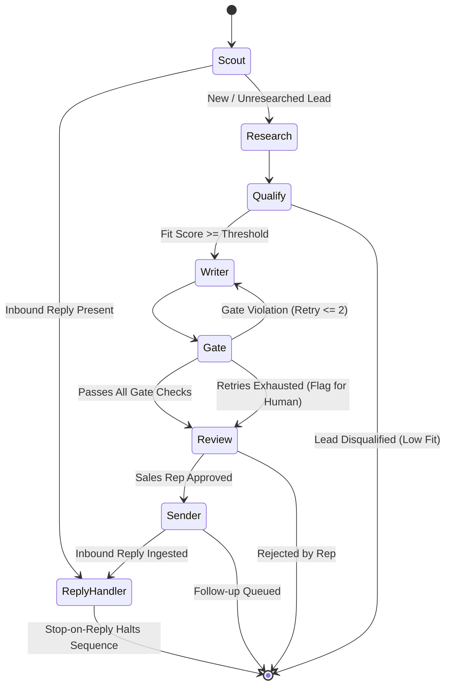

# Harvey AI Sales Agent — Final As-Built System Architecture

**Assignment:** EDXSO AI Engineer Intern Assignment 2  
**Repository:** `https://github.com/yashsham/cozy-start-friend.git`  
**Architecture Paradigm:** Zero-Cloud-LLM, Air-Gapped Local-First Architecture  
**Date:** November 2026  

---

## 1. Architectural Principles

1. **Strict Zero-Paid-LLM Constraint:**
   - 100% of LLM inference is processed locally through Ollama (`http://127.0.0.1:11434`).
   - 100% of embedding generation is executed in-process through `sentence-transformers/all-MiniLM-L6-v2`.
   - `AirGapViolationError` is deterministically raised if any outbound socket attempts to connect to commercial AI domains (`api.openai.com`, `api.anthropic.com`, `generativelanguage.googleapis.com`, `api.groq.com`).

2. **Stateful Multi-Agent Orchestration via LangGraph:**
   - Workflows are defined as cyclical, stateful `StateGraph` topologies with typed state schemas (`SalesAgentState`).
   - Nodes are decoupled, idempotent Python functions with bounded retry logic and deterministic interrupt points.

3. **Multi-Product Affinity & Cannibalization Prevention:**
   - A single unified agent manages multi-product catalogs.
   - Leads are scored across all active products. The product with the highest qualification score is selected, preventing conflicting or dual-pitch messaging.

4. **Deterministic Pre-Send Gates & Stop-on-Reply:**
   - Pre-send checks (word count $\le 125$, merge-tag leak prevention, spam cliché filters) are hard-coded deterministic regex and string operations, never delegated to LLM hallucination.
   - Any ingested prospect reply halts follow-up email queues instantaneously.

---

## 2. End-to-End Component Architecture

```mermaid
flowchart TD
    subgraph UI ["Frontend Layer (React 18 + Vite)"]
        Dashboard["Dashboard & Metrics"]
        CatalogUI["Product Catalog & ICPs"]
        ProspectsUI["Prospects & Discovery"]
        OutreachUI["Outreach Review & Generation"]
        RepliesUI["Inbox & Sentiment Analysis"]
    end

    subgraph API ["FastAPI Backend Layer (Port 8000)"]
        Router["FastAPI APIRouter (/api/v1)"]
        HealthEndpoint["/health & /models"]
        ProdEndpoint["/products & /icps"]
        ProspEndpoint["/prospects & /research"]
        OutreachEndpoint["/outreach & /replies"]
        AgentEndpoint["/agents/pipeline"]
    end

    subgraph Engine ["LangGraph Sales Agent Engine"]
        Scout["Scout Node"]
        Research["Research Node"]
        Qualify["Qualify Node (Multi-Product Match)"]
        Writer["Writer Node (Local Ollama Qwen2.5)"]
        Gate["Quality Gate Node (Deterministic)"]
        Review["Human Review Node (Approval Gate)"]
        Sender["Sender Node (Direct / Mock SMTP)"]
        ReplyHandler["Reply Handler & Stop-on-Reply"]
    end

    subgraph Data ["Local Persistence & Offline Cache"]
        SQLite[("SQLite WAL (v17 Schema)\nproducts, icps, scores, profiles")]
        VectorStore[("Local SentenceTransformers Cache\n384-dim Dense Vectors")]
        Fixtures[("Pre-Seeded Intelligence Fixtures\nAcme SaaS, Cyberdyne, NovaTech")]
    end

    UI <-->|HTTP REST / JSON| API
    API <--> Engine
    Engine <--> Data
```

---

## 3. LangGraph Workflow Execution State Machine

---

## 4. SQLite Schema Evolution Ledger (v17)

The application builds on upstream Sellbird migrations (v1–16) and establishes **Migration 17** for multi-product intelligence:

| Table | Migration | Purpose | Indexes |
| :--- | :--- | :--- | :--- |
| `products` | v17 | Multi-product catalog, descriptions, value propositions | `idx_products_slug`, `idx_products_active` |
| `product_icps` | v17 | Ideal Customer Profiles, target roles, qualification rules | `idx_product_icps_product` |
| `product_scores`| v17 | Fit scores (0-100), tiers, and affinity ranks per prospect | `idx_product_scores_prospect`, `idx_product_scores_product` |
| `business_profiles` | v17 | Company overview, value positioning, competitor notes | Primary Key `id` |
| `buying_signals` | v17 | Discrete business events (funding, hiring, tech migration) | `idx_buying_signals_prospect`, `idx_buying_signals_company` |
| `local_system_settings`| v17 | Offline flags, word count thresholds, local model tags | Primary Key `key` |

---

## 5. Security & Isolation Guarantee

1. **Air-Gap Capability:** System boots, runs discovery, computes embeddings, generates copy, and enforces safety gates without any internet connection.
2. **SSRF Containment:** Targets are validated against private IP spaces (`10.0.0.0/8`, `172.16.0.0/12`, `192.168.0.0/16`, `127.0.0.0/8`, `169.254.0.0/16`) and URI schemes are strictly restricted to `http` and `https`.
3. **Data Fencing:** All external DOM text and scraped signals are encased in `<untrusted source="...">` XML blocks before inclusion in prompts, mitigating prompt injection attacks.
4. **License Integrity:** Full AGPL-3.0 attribution maintained.
