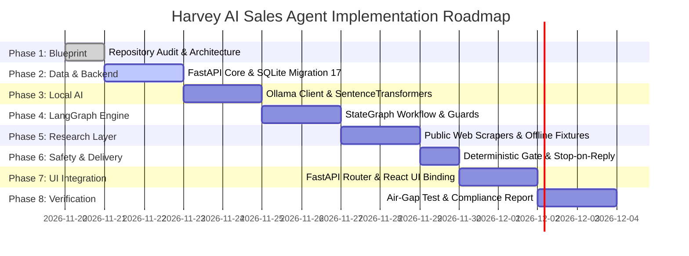

# Harvey AI Sales Agent — Implementation Roadmap
**Project:** Harvey AI Sales Agent  
**Assignment:** EDXSO AI Engineer Intern Assignment 2  
**Implementation Methodology:** Incremental, Test-Driven, Zero-Paid-LLM Architecture  
**Date:** November 2026  

---

## 1. Roadmap Overview & Timeline

The implementation transforms the existing Sellbird/Harvey codebase into the complete EDXSO Assignment 2 specification across **8 structured phases**. Each phase produces verified deliverables and executable tests before proceeding to the next.

---

## 2. Phase Breakdown & Acceptance Criteria

### Phase 1: Repository Audit & Architecture Blueprint (Completed)
- **Objective**: Conduct rigorous static analysis of upstream Sellbird codebase; map all 27 assignment requirements to technical components; document system architecture and execution roadmap.
- **Deliverables**:
  - `docs/REPOSITORY_AUDIT.md` (Detailed analysis of upstream modules, gaps, and reusability)
  - `docs/REQUIREMENTS_TRACEABILITY.md` (27-point requirement matrix with verification strategies)
  - `docs/SYSTEM_ARCHITECTURE.md` (Mermaid diagrams, LangGraph state machine, SQLite v17 schema)
  - `docs/IMPLEMENTATION_ROADMAP.md` (Phase-by-phase execution plan)
- **Acceptance Gate**: Documentation complete, verified, and aligned with evaluation criteria.

---

### Phase 2: Backend Foundation & Multi-Product Data Layer
- **Objective**: Establish the Python 3.11+ backend structure, configuration management, and SQLite WAL database layer with Migration 17.
- **Tasks**:
  1. Initialize `backend/` directory structure with modular architecture (`api/`, `core/`, `db/`, `models/`, `ai/`, `orchestration/`, `collectors/`, `safety/`).
  2. Implement `backend/core/config.py` using `pydantic-settings` to manage local environment variables (`OLLAMA_BASE_URL`, `OLLAMA_MODEL`, `DB_PATH`, `OFFLINE_MODE`).
  3. Port and extend `sellbird/state.py` into `backend/db/state.py`, preserving migrations 1–16.
  4. Write and apply **Migration 17** (`products`, `product_icps`, `product_scores` tables).
  5. Create Pydantic v2 domain schemas in `backend/models/` (`product.py`, `prospect.py`, `campaign.py`, `draft.py`).
- **Acceptance Gate**:
  - `pytest tests/test_state.py` passes 100%, successfully applying all 17 migrations and executing ACID operations in WAL mode.

---

### Phase 3: Local AI Inference & Vector Matching Engine
- **Objective**: Implement zero-cost, local-only inference via Ollama and semantic similarity matching via SentenceTransformers.
- **Tasks**:
  1. Build `backend/ai/ollama_client.py`: Asynchronous HTTP client for `http://127.0.0.1:11434` with retry logic, structured JSON schema enforcement, and timeout handling.
  2. Implement `backend/ai/leak_guard.py`: Deterministic network interceptor that guarantees zero outbound traffic to commercial AI domains (`api.openai.com`, `api.anthropic.com`, etc.).
  3. Build `backend/embeddings/vector_engine.py`: Loads `sentence-transformers/all-MiniLM-L6-v2` locally to compute 384-dimensional dense vectors and cosine similarities.
  4. Implement `backend/intelligence/icp_matcher.py`: Combines firmographic hard rules (industry, head count) with semantic cosine similarity to score product-prospect fit.
  5. Include an automated offline fallback simulator for environments where the Ollama daemon is offline during testing.
- **Acceptance Gate**:
  - `pytest tests/test_ollama_client.py` and `tests/test_vector_engine.py` pass with zero external cloud API calls.

---

### Phase 4: LangGraph Orchestration & Multi-Product Workflow
- **Objective**: Construct the cyclical, stateful agentic sales workflow using `langgraph.graph.StateGraph`.
- **Tasks**:
  1. Define `backend/orchestration/state.py`: The `SalesAgentState` TypedDict tracking prospect data, research observations, product affinities, generated drafts, gate review results, and dispatch status.
  2. Implement LangGraph Nodes:
     - `ScoutNode`: Queries discovery feeds for new candidate leads.
     - `ResearchNode`: Extracts tech stack, ATS signals, and contact info.
     - `QualifyNode`: Evaluates fit scores across all active products and selects the best product offering.
     - `WriterNode`: Generates highly personalized cold copy via local Ollama.
     - `GateCheckNode`: Runs deterministic safety checks via `sellbird/gate.py`.
     - `HumanReviewNode`: Conditional interrupt point for sales rep approval.
     - `SenderNode`: Dispatches approved messages via direct SMTP.
     - `ReplyHandlerNode`: Analyzes inbound emails and classifies intent.
  3. Wire conditional edges and compile the graph with a local SQLite checkpointer.
  4. Implement the **Deterministic Stop-on-Reply Guard**: Halts all scheduled follow-ups the instant an inbound reply is ingested.
- **Acceptance Gate**:
  - `pytest tests/test_langgraph_flow.py` verifies full traversal from raw prospect to validated draft and stops upon simulated reply.

---

### Phase 5: Web Research & Public Intelligence Layer
- **Objective**: Implement robust public web scrapers and pre-seeded offline fixtures for air-gapped execution.
- **Tasks**:
  1. Adapt upstream collectors (`discover.py`, `people.py`, `profile.py`, `ats.py`) into `backend/collectors/`.
  2. Implement SSRF protections in `backend/safety/ssrf_guard.py` (blocking loopback, private RFC1918 IPs, and AWS metadata addresses).
  3. Create `backend/collectors/cache_proxy.py`: Transparently caches scraped DOM snapshots to `backend/fixtures/` and serves cached records when offline.
  4. Seed 10 realistic corporate websites, ATS job postings, and Overpass results in `backend/fixtures/` for reliable demonstration.
- **Acceptance Gate**:
  - Research suite passes completely with network disconnected (`pytest tests/test_offline_research.py`).

---

### Phase 6: Deterministic Safety, Quality Gates & Dispatch
- **Objective**: Port and enforce pre-send validation rules and email delivery.
- **Tasks**:
  1. Integrate `sellbird/gate.py`, `email_style.py`, and `untrusted.py` into `backend/safety/`.
  2. Verify 100% catch rate on:
     - Unrendered merge tags (`{{first_name}}`, `[Company]`, `<Customer>`).
     - Banned clichés ("hope this email finds you well", "synergy", "game-changer").
     - Word count limits (strictly <= 125 words).
     - Missing unsubscribe mechanism or missing sender identity.
  3. Implement `backend/integrations/mail_service.py`: Direct SMTP/IMAP transport with local mock mailbox fallback.
- **Acceptance Gate**:
  - `pytest tests/test_gate_enforcement.py` verifies all non-compliant messages are rejected.

---

### Phase 7: Backend API & Frontend Integration
- **Objective**: Expose FastAPI REST endpoints and connect to the existing React + TypeScript dashboard.
- **Tasks**:
  1. Implement FastAPI routers:
     - `/api/products`: CRUD operations for multi-product catalog.
     - `/api/prospects`: List, filter, detail, and multi-product scores.
     - `/api/icp`: ICP definition and weighting configuration.
     - `/api/discovery`: Trigger discovery runs (OSM / public web).
     - `/api/outreach`: Fetch drafts, approve/reject/edit, and trigger generation.
     - `/api/replies`: Inbound conversations and sentiment analysis.
     - `/api/agents`: LangGraph node execution trigger and live logs.
     - `/api/models`: Ollama model listing, health check, and GPU stats.
     - `/api/system`: Offline status, system metrics, and backup controls.
  2. Wire `src/services/api.ts` to live FastAPI backend at `http://localhost:8000`.
  3. Validate end-to-end user actions across all 13 screens.
- **Acceptance Gate**:
  - Frontend interactively triggers backend workflows, reflecting real SQLite state in the UI.

---

### Phase 8: Testing, Security & Offline Acceptance Protocol
- **Objective**: Validate the system against all evaluation criteria and execute the mandatory offline acceptance test.
- **Tasks**:
  1. Run complete automated test suite (`pytest tests/` and `npm run test`).
  2. Execute `scripts/run_offline_acceptance_test.py`:
     - Disconnects active network or simulates complete socket isolation.
     - Executes lead discovery from local fixture.
     - Evaluates multi-product ICP fit using SentenceTransformers.
     - Drafts personalized cold email via local Ollama `Qwen2.5`.
     - Validates draft through deterministic quality gate.
     - Simulates inbound reply and verifies deterministic stop-on-reply guard.
  3. Produce `docs/OFFLINE_ACCEPTANCE_REPORT.md` documenting test results, latency benchmarks, and memory footprint.
  4. Author `docs/DEMO_GUIDE.md` with step-by-step instructions for assignment evaluators.
- **Acceptance Gate**:
  - 100% pass on offline acceptance test with zero network packets emitted to cloud AI endpoints.
