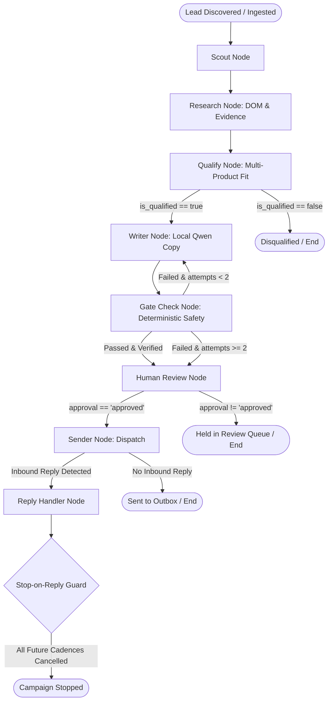

# Harvey AI Sales Agent — LangGraph Multi-Product Workflow Architecture
**System:** Harvey AI Sales Agent  
**Orchestration Engine:** `langgraph.graph.StateGraph` (Cyclical DAG)  
**State Schema:** `SalesAgentState` (TypedDict)  
**Guards:** Deterministic Stop-on-Reply & Pre-Send Quality Gates  

---

## 1. Workflow Architecture & Graph Topology

Harvey AI orchestrates discovery, qualification, copywriting, review, delivery, and inbound handling through a modular, cyclical directed graph:

---

## 2. Node Responsibilities & State Transitions

### 2.1 `ScoutNode`
- **Purpose**: Initializes the lead state, extracts company names and email domains.
- **Inputs**: Prospect raw contact attributes.
- **State Modifications**: Clears prior execution flags, resets attempt counters.

### 2.2 `ResearchNode`
- **Purpose**: Collects public evidence from DOM, ATS, and firmographic sources.
- **Safety**: Wraps all untrusted external content in `<untrusted source="...">...</untrusted>` XML fences to neutralize prompt injection attacks.
- **Provenance**: Preserves source URLs and observation collector tags.

### 2.3 `QualifyNode` (Multi-Product Routing)
- **Purpose**: Prevents product cannibalization by evaluating the prospect against all active catalog products.
- **Algorithm**:
  1. Computes local dense semantic similarity using `SentenceTransformers('all-MiniLM-L6-v2')`.
  2. Applies rule-based multipliers for matching target industry verticals and executive buyer job titles.
  3. Identifies the highest affinity product and assigns `fit_score` and `fit_tier` (`very_high`, `high`, `medium`, `low`).
- **Conditional Branch**: If `fit_score < 55.0`, the lead is disqualified and the graph terminates before wasting compute on copy generation.

### 2.4 `WriterNode`
- **Purpose**: Crafts a concise, hyper-personalized cold outreach email using the local Ollama `qwen2.5:7b-instruct` model.
- **Constraints**: Enforces `WRITER_SYSTEM_PROMPT` rules:
  - Strictly under 125 words (60–90 words target).
  - Lowercase subject lines (e.g. `quick question for acme`).
  - Zero placeholder merge-tags.
  - Low-friction, soft Call-to-Action.

### 2.5 `GateCheckNode` (Deterministic Safety Guard)
- **Purpose**: Evaluates draft copy with 100% deterministic code before it can ever be sent or approved.
- **Rules Tested**:
  1. Word count bound ($\le 125$ words).
  2. Zero unrendered merge tags (`{{name}}`, `[Company]`, `<name>`).
  3. Zero banned spam clichés ("hope this email finds you well", "synergy", "game-changer").
- **Retry Mechanism**: If gate checks fail and `draft_attempts < 2`, the graph routes back to `WriterNode` to re-generate compliant copy.

### 2.6 `HumanReviewNode` (Human-in-the-Loop Control)
- **Purpose**: Governs outbound dispatch.
- **Behavior**:
  - Holds copy in status `pending` for human sales rep inspection and approval.
  - Auto-approves only when configured and when `fit_score >= 70.0` with 0 gate violations.

### 2.7 `SenderNode`
- **Purpose**: Direct SMTP dispatch or recorded mock send with immutable timestamping and outbox ID tracking.

### 2.8 `ReplyHandlerNode` & Deterministic Stop-on-Reply Guard
- **Purpose**: Analyzes inbound replies (positive, objection, unsubscribe, out-of-office).
- **Non-Negotiable Rule (REQ-17)**: The instant an inbound reply is ingested for a prospect, `stop_campaign = True` is unconditionally set. All pending sequence follow-ups for that prospect are immediately aborted.
