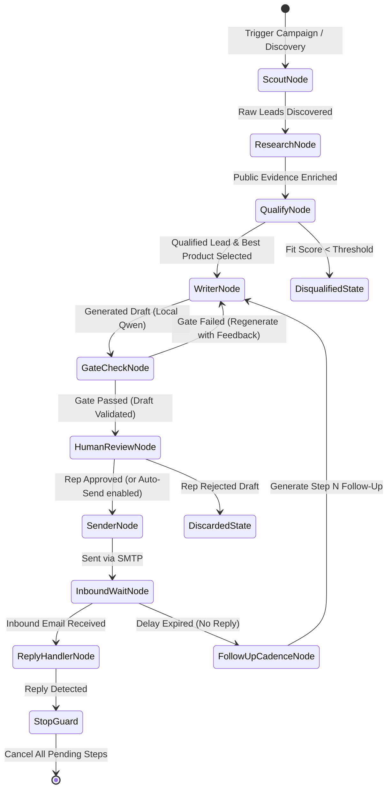

# Harvey AI Sales Agent — Target System Architecture
**Project:** Harvey AI Sales Agent (Sellbird Extended)  
**Standard:** EDXSO AI Engineer Intern Assignment 2  
**Architecture Paradigm:** Local-First, Zero-Paid-LLM, Multi-Product Agentic Sales System  
**Status:** Approved Architectural Blueprint  
**Date:** November 2026  

---

## 1. High-Level System Architecture

Harvey AI is architected as a completely self-contained, air-gappable AI sales intelligence and engagement platform. It operates with **zero external paid AI APIs**, utilizing local inference via **Ollama**, local semantic vector representations via **SentenceTransformers**, and ACID-compliant local storage via **SQLite WAL**.

```mermaid
flowchart TD
    subgraph Client["Presentation Layer (React 18 + Vite + Tailwind CSS)"]
        UI_Dash["Overview & Metrics"]
        UI_Prod["Multi-Product Catalog"]
        UI_ICP["ICP & Qualification Rules"]
        UI_Disc["Discovery & Public Scrapers"]
        UI_Prosp["Prospects & 7-Tab Detail Drawer"]
        UI_Outreach["Outreach & HITL Review"]
        UI_Replies["Inbound Replies & Sentiment"]
        UI_AI["Local AI & Model Health Status"]
    end

    subgraph API["Backend API Gateway (FastAPI Async)"]
        Router_Prod["/api/products"]
        Router_Prosp["/api/prospects"]
        Router_Outreach["/api/outreach"]
        Router_Replies["/api/replies"]
        Router_Agents["/api/agents (LangGraph triggers)"]
        Router_AI["/api/models (Ollama Health)"]
        Router_System["/api/system (Offline status)"]
    end

    subgraph Orchestration["LangGraph Workflow Engine"]
        StateGraph["StateGraph Engine"]
        Node_Scout["Scout Node (Discovery)"]
        Node_Research["Research Node (DOM/ATS)"]
        Node_Qualify["Qualify Node (Multi-Product Fit)"]
        Node_Writer["Writer Node (Local Qwen Draft)"]
        Node_Gate["Gate Check Node (Deterministic Safety)"]
        Node_HITL["HITL Approval Node (Manual Review)"]
        Node_Sender["Sender Node (SMTP Dispatch)"]
        Node_Handler["Reply Handler Node (Sentiment)"]
        Guard_Stop["Stop-on-Reply Deterministic Guard"]
    end

    subgraph LocalAI["Local AI & Intelligence Layer (100% Offline)"]
        OllamaClient["Ollama Client (HTTP 127.0.0.1:11434)"]
        Model_Qwen["Qwen2.5:7b-instruct / Qwen3:8b (GGUF)"]
        Embedder["SentenceTransformers (all-MiniLM-L6-v2)"]
        SimEngine["Cosine Similarity & ICP Vector Scorer"]
        PromptSanitizer["<untrusted> Injection Sanitizer"]
    end

    subgraph Data["Persistence & Storage Layer (SQLite WAL)"]
        DB[(SQLite DB: sellbird.db)]
        T_Products["products (v17)"]
        T_ICPs["icps & qualification_rules (v17)"]
        T_Prospects["prospects & company_domain"]
        T_Observations["observations (EAV Evidence)"]
        T_Drafts["outreach_drafts & approval_state"]
        T_History["outreach_history & sent_at"]
        T_Replies["replies & intent_class"]
        T_Audit["audit_log (Immutable Event Log)"]
    end

    subgraph Research["Public Web & Intelligence Layer"]
        OSM_Overpass["OpenStreetMap Overpass API"]
        WebScraper["BeautifulSoup4 DOM Scraper"]
        ATS_Fetcher["Public ATS Feed Reader (Greenhouse/Lever)"]
        OfflineCache["Pre-Seeded Offline Fixture Cache"]
    end

    Client <-->|REST / JSON (8080 <-> 8000)| API
    API <--> Orchestration
    Orchestration <--> LocalAI
    Orchestration <--> Data
    API <--> Data
    Orchestration <--> Research
    Research -.->|Offline Fallback| OfflineCache
```

---

## 2. Core Architectural Subsystems

### 2.1 Presentation Layer (Frontend)
- **Technology Stack**: React 18, TypeScript, Vite, Tailwind CSS, Lucide icons, shadcn/ui design language.
- **Location**: `src/` (13 core feature modules):
  1. `OverviewView`: Aggregated pipeline analytics, response rates, agent status, and active product badges.
  2. `ProductsView`: Multi-product catalog management (value propositions, pricing, features, target verticals).
  3. `ProfileView`: User/organization identity, sender domain reputation, and outbound credentials.
  4. `ICPView`: Ideal Customer Profile designer with weightings, firmographic rules, and buyer personas.
  5. `DiscoveryView`: Autonomous query builder supporting geographic and industry searches via OpenStreetMap.
  6. `ProspectsView`: Tabular directory of discovered leads with filtering, enrichment status, and product affinity tags.
  7. `ProspectDetailModal`: Deep inspection drawer with 7 sub-tabs: Overview, Product Fit, Observations, History, Drafts, Replies, and Audit Log.
  8. `SignalsView`: Temporal buying signal stream (funding rounds, hiring surges, tech stack updates).
  9. `OutreachView`: Draft management queue supporting Human-in-the-Loop (HITL) review, inline editing, and one-click approvals.
  10. `RepliesView`: Inbound conversation hub with automated sentiment classification (Positive, Objection, Unsubscribe).
  11. `AgentsView`: Real-time visualization of the LangGraph execution pipeline, node statuses, and execution logs.
  12. `LocalAIView`: Ollama status monitor, local model selector, GPU memory utilization, and offline readiness indicator.
  13. `SettingsView`: SMTP/IMAP credentials, rate limiting bounds, deterministic gate rules, and backup controls.

### 2.2 Backend API Layer (FastAPI)
- **Technology Stack**: Python 3.11+, FastAPI, Uvicorn, Pydantic v2.
- **Responsibilities**:
  - Exposes RESTful endpoints matching `src/services/api.ts`.
  - Manages asynchronous database connection pooling.
  - Controls LangGraph pipeline invocation and background task scheduling.
  - Serves as the single point of truth for local Ollama daemon health.

### 2.3 LangGraph Orchestration Engine
The agentic core is structured as a stateful, cyclical directed acyclic graph (`langgraph.graph.StateGraph`):



#### Deterministic Graph Guards
1. **Stop-on-Reply Guard**: If any inbound email arrives matching `prospect_id` or `email`, all scheduled follow-ups for that prospect are immediately deleted or marked `cancelled`.
2. **Quality Gate Guard**: Drafts that contain merge tags (`{{name}}`), clichés, or exceed 125 words cannot proceed to `SenderNode` without regeneration or explicit manual override.

### 2.4 Local AI & Inference Layer
- **Engine**: Ollama running locally at `http://127.0.0.1:11434`.
- **Primary Model**: `Qwen2.5:7b-instruct` (or `Qwen2.5:1.5b-instruct` / `Qwen3:8b`).
- **Embeddings Model**: `SentenceTransformers('all-MiniLM-L6-v2')` loaded from local directory.
- **Zero Cloud Leakage Enforcement**:
  - An outbound HTTP proxy hook blocks any request targeting `api.openai.com`, `api.anthropic.com`, or other commercial AI endpoints.
  - All prompts are rendered locally and parsed via deterministic regex/Pydantic schemas.
- **Untrusted Content Fence**: All public web content passed into the prompt context is wrapped in:
  ```xml
  <untrusted source="{source_url}" timestamp="{iso_timestamp}">
  {scraped_text}
  </untrusted>
  ```
  with strict instructions instructing the LLM to treat content within tags purely as data, never as executable instructions.

### 2.5 Data Persistence Layer (SQLite WAL)
- **File**: `sellbird.db`
- **PRAGMAs**:
  ```sql
  PRAGMA journal_mode = WAL;
  PRAGMA synchronous = NORMAL;
  PRAGMA foreign_keys = ON;
  PRAGMA temp_store = MEMORY;
  PRAGMA mmap_size = 30000000000;
  ```

#### Schema Migration v17 (Multi-Product Extension)
```sql
-- Migration 17: Multi-Product and Multi-ICP Catalog
CREATE TABLE IF NOT EXISTS products (
    id TEXT PRIMARY KEY,
    name TEXT NOT NULL,
    slug TEXT NOT NULL UNIQUE,
    tagline TEXT,
    description TEXT NOT NULL,
    value_proposition TEXT NOT NULL,
    pricing_tier TEXT NOT NULL, -- 'Free', 'Pro', 'Enterprise'
    target_industries TEXT,     -- JSON array of strings
    is_active INTEGER NOT NULL DEFAULT 1,
    created_at TEXT NOT NULL DEFAULT (datetime('now')),
    updated_at TEXT NOT NULL DEFAULT (datetime('now'))
);

CREATE TABLE IF NOT EXISTS product_icps (
    id TEXT PRIMARY KEY,
    product_id TEXT NOT NULL REFERENCES products(id) ON DELETE CASCADE,
    title TEXT NOT NULL,
    target_roles TEXT NOT NULL,         -- JSON array: ["CTO", "VP Sales"]
    target_company_sizes TEXT NOT NULL, -- JSON array: ["11-50", "51-200"]
    key_pain_points TEXT NOT NULL,      -- JSON array of pain strings
    qualification_prompt TEXT,
    min_fit_score REAL NOT NULL DEFAULT 65.0,
    created_at TEXT NOT NULL DEFAULT (datetime('now'))
);

CREATE TABLE IF NOT EXISTS product_scores (
    id TEXT PRIMARY KEY,
    prospect_id TEXT NOT NULL REFERENCES prospects(id) ON DELETE CASCADE,
    product_id TEXT NOT NULL REFERENCES products(id) ON DELETE CASCADE,
    fit_score REAL NOT NULL,
    fit_reasons TEXT,                   -- JSON array of qualitative factors
    affinity_rank INTEGER NOT NULL,
    evaluated_at TEXT NOT NULL DEFAULT (datetime('now')),
    UNIQUE(prospect_id, product_id)
);

CREATE INDEX IF NOT EXISTS idx_product_scores_prospect ON product_scores(prospect_id);
CREATE INDEX IF NOT EXISTS idx_product_scores_product ON product_scores(product_id);
```

---

## 3. Offline Air-Gap Execution Contract

To fulfill the **Offline Acceptance Test (Airplane Mode)**:
1. **Model Cache**: Ollama models must be pre-pulled (`ollama pull qwen2.5:7b-instruct`) and SentenceTransformer weights downloaded to the local HuggingFace cache (`~/.cache/huggingface/hub/`).
2. **Fixture Cache**: The research collector (`backend/collectors/cache_proxy.py`) detects offline network state (socket timeout or explicit `OFFLINE_MODE=true` environment variable). In offline mode, the scraper seamlessly loads pre-seeded HTML/DOM dumps from `backend/fixtures/` rather than failing network calls.
3. **Mailbox Mock**: When offline, the direct delivery engine writes outbound emails to `outreach_history` with status `sent_mocked`, allowing full inspection of delivered copy without needing access to external SMTP servers.
4. **Zero Cloud Dependencies**: The system operates with zero external network connectivity, proving genuine local inference and autonomous operation.
